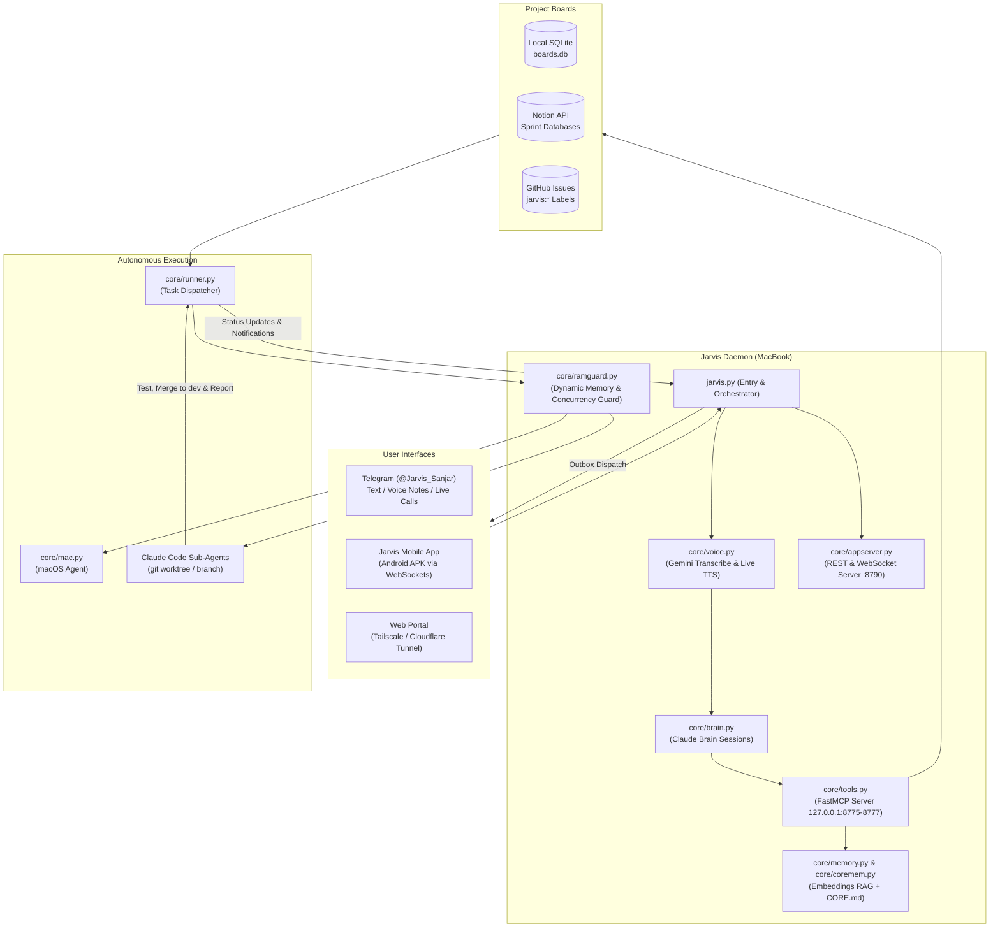
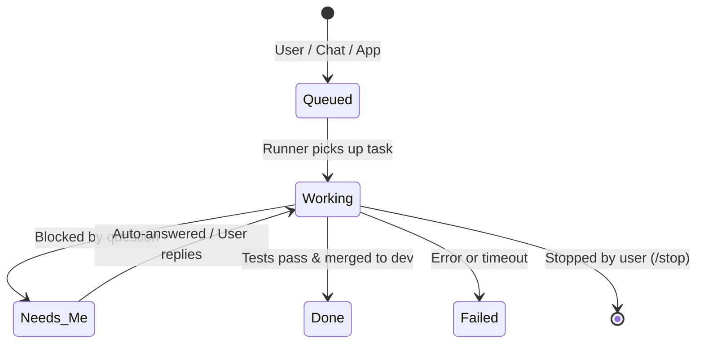

# 🤖 Jarvis

> An autonomous personal assistant and developer companion for macOS. Jarvis coordinates Claude Code worker agents across software repositories, automates system tasks, and provides multi-modal interaction via Telegram, a native companion app, and a real-time web portal.

[](https://apple.com)
[](https://python.org)
[](https://github.com/jlowin/fastmcp)
[](https://telegram.org)
[](https://tailscale.com)

---

## Table of Contents

- [Overview](#overview)
- [System Architecture](#system-architecture)
- [Repository Layout](#repository-layout)
- [Key Features](#key-features)
  - [1. Communication & Interfaces](#1-communication--interfaces)
  - [2. Autonomous Worker Pipeline](#2-autonomous-worker-pipeline)
  - [3. Memory & Context Engine](#3-memory--context-engine)
  - [4. macOS Control & Physical Security](#4-macos-control--physical-security)
  - [5. External & Workspace Integrations](#5-external--workspace-integrations)
- [Project Boards](#project-boards)
- [Resource Management & Concurrency](#resource-management--concurrency)
- [Operations & Maintenance](#operations--maintenance)
  - [Service Lifecycle](#service-lifecycle)
  - [CLI Tools Cheatsheet](#cli-tools-cheatsheet)
  - [Telegram Command Reference](#telegram-command-reference)
- [Configuration](#configuration)

---

## Overview

Jarvis runs 24/7 on macOS as a login daemon. It serves as the central orchestration node for all development projects and personal workflows:

- **Multi-Modal Communication**: Call or message Jarvis on Telegram (`@Jarvis_Sanjar`), chat through the Android companion app, or use the web dashboard.
- **Autonomous Software Engineering**: Converts natural language requests into structured tickets on project boards, then dispatches Claude Code (`claude -p`) workers to implement, test, and merge code on isolated branches.
- **System Control & Automation**: Executes shell commands, AppleScript automations, keyboard/mouse actions, and monitors physical Mac security.
- **Persistent Tiered Memory**: Maintains long-term semantic conversation search and a curated core memory list of permanent user preferences and rules.

See the high-level design specification in [docs/JARVIS_PLAN.md](docs/JARVIS_PLAN.md).

---

## System Architecture



---

## Repository Layout

```
├── jarvis.py                 # Main entry point: Telegram listeners, notifications, daemon loop
├── core/                     # Core system modules
│   ├── appserver.py          # REST & WebSocket server for Web & Mobile app (port 8790)
│   ├── autoanswer.py         # Automatic resolution for worker "Needs me" blockers
│   ├── board.py              # Notion board API connector & caching
│   ├── brain.py              # Claude conversational sessions (calls, chat, context)
│   ├── config.py             # Global configurations, file paths, safety policies
│   ├── coremem.py            # Curated persistent memory (CORE.md) & consolidation
│   ├── drive.py & google.py  # Google Workspace integration (Docs, Sheets, Drive)
│   ├── expenses.py           # Automated flatmates receipt & expense calculation
│   ├── ghboard.py            # GitHub Issues & Projects connector
│   ├── guard.py              # Physical macOS activity watchdog (screen & camera alerts)
│   ├── livestats.py          # Real-time social metrics scraper
│   ├── localboard.py         # Local SQLite project board implementation (boards.db)
│   ├── mac.py                # macOS automation worker (AppleScript, GUI interaction)
│   ├── memory.py             # Semantic RAG memory (Gemini embeddings + Haiku threads)
│   ├── origin.py             # Request routing: returns results to the originating chat
│   ├── outbox.py             # Unified Telegram message delivery queue
│   ├── ramguard.py           # Adaptive concurrency controller for 8 GB Mac
│   ├── runner.py             # Autonomous worker queue runner & monitor
│   ├── selfcheck.py          # Periodic self-diagnostic watchdog (every 15 min)
│   ├── slides.py             # Programmatic presentation generator (Google Slides / ODP)
│   ├── tools.py              # FastMCP tool registrations for Claude Brain
│   └── voice.py              # Audio streaming, Gemini speech-to-text, and Live TTS
├── web/                      # Zero-build vanilla HTML/JS frontend dashboard
├── config/                   # System configurations
│   ├── projects.json.example # Template for registered projects and board mappings
│   └── rules.md.example      # Template for standing instructions given to workers
├── scripts/                  # Operational tools and automation scripts
│   ├── board.py              # CLI for viewing and managing project boards
│   ├── heavy.py              # Mutex lock wrapper for memory-intensive operations
│   ├── login.py / relogin.py # Telegram authentication handlers
│   ├── mac.py                # Mouse, keyboard, and screenshot automation helper
│   ├── real_chrome.py        # Authenticated Chrome session automation
│   ├── restart_when_idle.sh  # Safe restart script waiting for active workers
│   └── send_file.py          # Outbox utility to send media/files to Telegram
├── tests/                    # Comprehensive automated test suite
├── docs/                     # Architecture, specifications, and design plans
└── var/                      # Runtime state, databases, logs, screenshots (gitignored)
```

---

## Key Features

### 1. Communication & Interfaces

- **Telegram Bot & Account**:
  - Voice notes transcribed immediately; replies streamed via text and spoken audio.
  - Full-duplex voice calls powered by Gemini Live TTS with real-time interruption detection (talking over pauses playback in ~0.2 s).
  - Outbound contact calling: calls third parties via Telegram to deliver urgent messages and returns transcribed summaries.
  - Inbound file handling: photos, PDFs, and documents sent to the bot are saved to `var/state/inbox/` and analyzed by the brain.
- **Companion Mobile App & Web Portal**:
  - Lightweight Android APK (~200 KB) and responsive web interface (`web/`).
  - Project-specific chat threads with isolated Claude sessions.
  - Live audio calls over WebSockets and rich image/file previews.
  - Remote connectivity via Tailscale userspace daemon (`jarvis-mac`).
- **Contextual Answer Routing**:
  - Results are automatically delivered back to the specific platform and chat where the task was initiated (Telegram DM or App project chat).
  - Sensitive passwords and credentials are scrubbed from general logs and only displayed inside authenticated sessions.

### 2. Autonomous Worker Pipeline

- **Autonomous Ticket Execution**:
  - Tasks marked as `Queued` on project boards are picked up automatically by `core/runner.py`.
  - Workers run in isolated project directories and git worktrees without requiring interactive human confirmation.
  - Automatic resolution of blocking questions: `core/autoanswer.py` inspects project documentation, memories, and rules to answer worker questions without waking the user unless human judgment is truly required.
- **Safe Git Workflow**:
  - Workers always branch from `dev`, run tests, and merge back into `dev` autonomously.
  - Pushes to `main`/`master` are strictly protected and require explicit temporary grants (`core/grants.py`).

### 3. Memory & Context Engine

- **Dual-Tier Memory**:
  - **Semantic RAG Memory**: Past conversations, transcripts, and facts are indexed using Gemini embeddings (`core/memory.py`). Claude Haiku organizes messages into thematic threads for contextual recall.
  - **Core Memory (`CORE.md`)**: A concise, curated markdown registry of lasting decisions, preferences, and operational rules injected into every prompt. A nightly consolidation pass refines and deduplicates entries.
- **Automated Privacy Scrubbing**:
  - All incoming and outgoing text passes through scrubbing filters before storage; API keys, tokens, and passwords are never persisted to long-term memory.

### 4. macOS Control & Physical Security

- **System Actions**:
  - Quick single-step actions (`run_on_mac`) execute shell commands or AppleScript directly.
  - Complex UI tasks (`mac_task`) launch an autonomous agent that navigates the desktop, inspects the screen, clicks, and types.
- **Mac Guard (`/guard`)**:
  - When armed, any physical keyboard, mouse, or trackpad movement triggers an immediate silent alert to Telegram with desktop screenshots and webcam photos.
  - Operates across system restarts and distinguishes human interaction from automated agent activity.

### 5. External & Workspace Integrations

- **Google Workspace**:
  - Authenticated via PKCE OAuth (`core/google.py`).
  - Search, read, create, and update Google Docs, Sheets, and Slides.
  - Generates presentations from outlines by synthesizing minimal `.odp` bundles and importing them cleanly into Google Slides.
- **Flatmates Expense Tracker**:
  - Reads receipts, transfer screenshots, and expense messages from Telegram group chats (`core/expenses.py`).
  - Calculates net debts across flatmates and posts consolidated balance summaries.
- **Social Media Live Stats**:
  - Headless browser automation tracks Instagram followers, engagement, and video metrics on demand without third-party API keys.

---

## Project Boards

Jarvis supports multi-backend project tracking. Each project configured in `config/projects.json` can use any of the following backends:

| Backend | Storage | Best For | Configuration Key |
|---|---|---|---|
| **Local SQLite** | `var/state/boards.db` | High-speed, offline-capable, local tasks | `"local": true` |
| **Notion** | Notion Database API | Visual planning, team sharing, rich cards | `"board": "<database_id>"` |
| **GitHub Issues** | GitHub Projects / Labels | Open-source repos, public tracking (`jarvis:*`) | `"github": { "repo": "..." }` |

### Ticket States



- **Queued**: Ready to be processed by an available worker.
- **Working**: Worker is actively writing code and running tests.
- **Needs me**: Worker requires clarification or manual action (Jarvis attempts to auto-answer first).
- **Done**: Changes are verified, committed, merged to `dev`, and summarized.
- **Failed**: Worker encountered an unrecoverable failure; re-queued up to 2 times automatically.

---

## Resource Management & Concurrency

Jarvis is optimized to run smoothly on Apple Silicon Macs with 8 GB unified memory:

- **Dynamic RAM Guard (`core/ramguard.py`)**:
  - Continuously measures free memory, inactive memory, purgeable pages, and swap utilization.
  - Automatically restricts concurrent workers when system RAM pressure rises.
  - Guarantees a minimum 1 GB system headroom reserve.
- **Resource Locking (`scripts/heavy.py`)**:
  - Mutex wrapper for memory-intensive operations (Docker builds, Gradle compilations, emulators, video rendering).
  - Ensures only one heavy compilation job runs at any given moment.

---

## Operations & Maintenance

### Service Lifecycle

Jarvis is managed via macOS `launchd`:

```bash
# Check status / tail daemon logs
tail -f var/logs/jarvis.log

# Graceful restart (waits for running workers and active calls to finish)
scripts/restart_when_idle.sh

# Stop daemon completely
launchctl bootout gui/$(id -u)/com.sanjar.jarvis

# Start daemon
launchctl bootstrap gui/$(id -u) ~/Library/LaunchAgents/com.sanjar.jarvis.plist

# Run manually in foreground (for debugging)
uv run jarvis.py
```

> [!CAUTION]
> Never use `pkill -f jarvis.py`! Force-killing terminates active Claude Code workers mid-ticket and stops the background `caffeinate` process keeping the Mac awake. Use `scripts/restart_when_idle.sh` instead.

### CLI Tools Cheatsheet

| Script | Purpose | Example Usage |
|---|---|---|
| `scripts/board.py` | Manage local SQLite boards | `uv run scripts/board.py list Jarvis` |
| `scripts/board.py show` | View ticket details and logs | `uv run scripts/board.py show <ticket_id>` |
| `scripts/heavy.py` | Run memory-intensive commands safely | `scripts/heavy.py ./gradlew assembleDebug` |
| `scripts/send_file.py` | Deliver a file to Telegram DM | `uv run scripts/send_file.py report.pdf "Weekly report"` |
| `scripts/real_chrome.py` | Open an authenticated Chrome window | `uv run scripts/real_chrome.py open "https://..."` |
| `scripts/notion_to_local.py` | Migrate Notion board to SQLite | `uv run scripts/notion_to_local.py <project> --switch` |
| `scripts/ts.sh` | Check Tailscale remote status | `scripts/ts.sh status` |

### Telegram Command Reference

| Command | Description |
|---|---|
| `/status [project]` | Shows running workers, RAM usage, and pending ticket counts |
| `/stop <project\|mac>` | Immediately halts an active worker without failing the ticket |
| `/call` | Requests Jarvis to initiate an audio call with you |
| `/transcript` | Fetches the full transcript of the latest voice call |
| `/guard [on\|off\|status]` | Arms or disarms the physical Mac intrusion guard |
| `/clear` | Archives current conversation context into long-term memory and resets chat |
| `/logoutall` | Terminates active Web, App, and remote sessions |

---

## Configuration

Jarvis requires configuration via `.env` and `config/projects.json`.

1. **Environment Variables (`.env`)**:
   Copy `.env.example` to `.env` and configure required API credentials:
   - `TELEGRAM_API_ID`, `TELEGRAM_API_HASH`, `TELEGRAM_PHONE` (Telegram client)
   - `ANTHROPIC_API_KEY` (Claude Brain and worker sessions)
   - `GEMINI_API_KEY` (Voice transcription, Gemini Live TTS, and embeddings)
   - `APP_TOKEN` (Shared secret for Android App / Web Portal)
   - `GOOGLE_OAUTH_CLIENT_ID`, `GOOGLE_OAUTH_CLIENT_SECRET` (Optional: Google Workspace)

2. **Project Registry (`config/projects.json`)**:
   Copy `config/projects.json.example` to `config/projects.json` to configure managed repositories:
   ```json
   {
     "MyProject": {
       "path": "/Users/username/dev/my_project",
       "local": true,
       "auto_answer": true
     }
   }
   ```
   Changes to `config/projects.json` are hot-reloaded automatically by Jarvis without requiring a restart.

---

## License

Private repository. All rights reserved.
