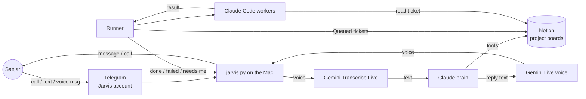
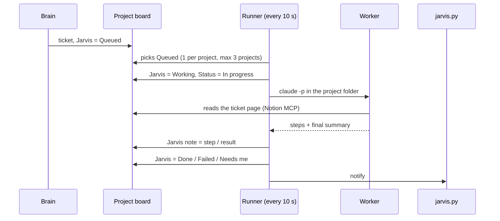

# Jarvis — system flow

One program (`jarvis.py`) runs on the Mac as a login agent. It is logged in to Telegram as
@Sanjarbek177 and only answers Sanjar.

## 1. Talking to Jarvis

- **Call**: my voice → Gemini transcribe → Claude (call brain) → Gemini voice → call.
  Jarvis stops talking if I talk over it (3+ words).
- **Text / voice message**: voice is transcribed first ("I heard: …"), then Claude (chat brain)
  replies in Telegram.
- Commands: `/status [project]`, `/stop <project>`, `/call`, `/transcript`.

## 2. Brain tools

| Tool | Does |
|---|---|
| `add_task` | new ticket on the project's board, Jarvis = Queued |
| `queue_ticket` | hand an existing ticket to Jarvis |
| `get_status` | what Jarvis is doing (Queued / Working / Needs me / recent Done) |
| `project_board` | whole board: counts + open tickets |
| `answer_task` | my answer to a "Needs me" ticket, queue it again |
| `screenshot` | page or Mac screen → Telegram |
| `call_contact` | call someone and pass on my message |
| `hang_up` | end the call |

## 3. Task flow

- Each project board has a **Jarvis** column (Queued → Working → Needs me / Done / Failed)
  and **Jarvis note**. Tickets with an empty Jarvis column are never touched.
- Workers run without approvals, with a short never-do list; each project keeps its own
  Claude session.

## 4. Jarvis reaching me

- Every result → Telegram message (+ screenshots).
- **Calls me** when a ticket needs me or fails, and a daily summary at 20:00.
  No calls 23:00–08:00, at most one per 10 min. On a call already → it tells me there.

## 5. Calling other people

`call_contact` finds the person in the Jarvis account's contacts/chats, calls them with a
"guest" brain that can only deliver the message and hang up, then sends me the transcript.

## Where things are

Code map and run commands: [../README.md](../README.md). Settings: `core/config.py`,
`config/projects.json`. Logs: `var/logs/jarvis.log`.
