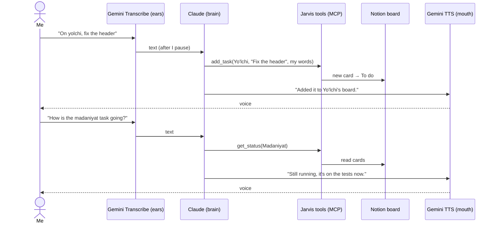
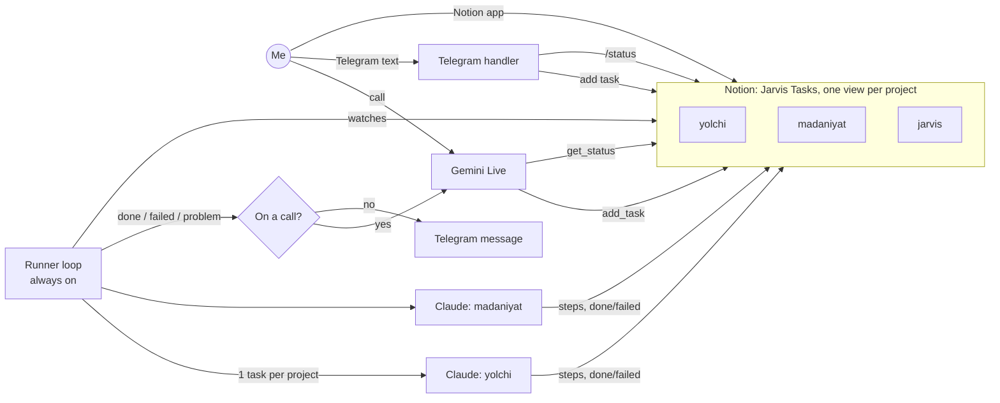
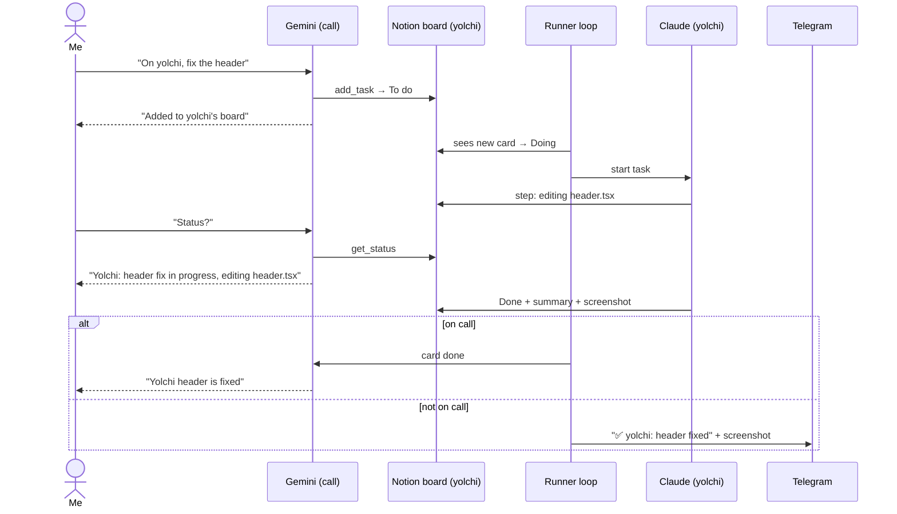

# Jarvis — control my MacBook from Telegram

## Goal
My MacBook stays on at home. I send a message to a Telegram bot from my phone
("fix the bug in yolchi", "check Upwork for new jobs", "what's the server status").
Claude Code runs the task on the Mac, then sends me back a short summary of what it did.

## How it works (simple picture)

```
Phone (Telegram)  ──>  Telegram bot (runs on Mac, always on)
                              │
                              ▼
                    Claude Code (headless: `claude -p ...`)
                     - reads/edits code, runs commands
                     - uses Chrome, Notion, servers, etc.
                              │
                              ▼
                    Short summary + files/screenshots ──> back to Telegram
```

## Parts

1. **Telegram bot** (Python, `python-telegram-bot`, managed with `uv`)
   - Created with @BotFather, token kept in a `.env` file.
   - Only answers MY Telegram user ID. Everyone else is ignored.
   - Uses long polling, so no open ports, no public server, no domain needed.

2. **Claude runner**
   - For each message, the bot runs Claude Code in headless mode:
     `claude -p "<my message>" --output-format stream-json --resume <session>`
   - Uses my existing Claude login (subscription), so no extra API bill.
   - Keeps one ongoing session per "chat", so I can say "now also add tests"
     and it remembers what we were doing. `/new` starts fresh.
   - Runs in a chosen project folder. `/cd yolchi` switches project.

3. **Live notifications while it works**
   - When a task starts: "Got it, working on it…"
   - While it runs, I get notified on each real step:
     "reading the project", "found the bug in X", "running tests", "tests pass".
     These come from Claude's live output stream, turned into short plain lines.
   - Two kinds of messages, so my phone isn't buzzing all the time:
     - **silent** updates (no sound) for normal progress
     - **loud** notification only when it's done, failed, or needs me
   - When done: short summary — what changed, which files, did tests pass,
     anything that needs me. Long output goes as a `.md` file attachment.
   - Can run tasks on several projects at once; each message is tagged
     with the project name, e.g. `[yolchi] tests pass`.

4. **Real-time conversation**
   - I can write to it while it's working, not only before/after:
     - "also fix the header" → added to the current task
     - "stop, wrong approach" → it stops and listens
     - "how is it going?" → it answers right away from what it's doing
   - It can ask ME questions mid-task ("which file did you mean?") and wait
     for my reply in Telegram.

5. **Voice messages (both ways)**
   - **Me → Jarvis:** I send a voice message, it's turned into text on the Mac
     (local Whisper, free, private) and treated like a normal message.
     It replies "I heard: …" so I can catch mistakes.
   - **Jarvis → me:** summaries can come back as a voice message too
     (Mac text-to-speech → Telegram voice note). Toggle with `/voice on|off`.
   - Uzbek/Russian/English should all work for voice input.

6. **Live voice call (real-time conversation)**
   - I call Jarvis and just talk, like a phone call. It answers by voice,
     I can interrupt it, it can start tasks and tell me how they're going.
   - How the call works:
     - a fast "voice brain" listens, understands, and talks back quickly
     - real work (code, commands, browser) is handed to Claude Code in the
       background, so the call never freezes while a task runs
     - while I'm still on the call it tells me "tests are running", "done, 3 files changed"
     - if I hang up, task updates keep coming in Telegram as usual
   - Problem: a normal Telegram bot can't receive calls. Options:
     - **A. Small web page on my phone (recommended)** — one "Call Jarvis"
       button, it works like a call in the browser. It reaches my Mac through a
       private network (Tailscale), so it isn't public. Most reliable, free.
     - **B. Real Telegram call** — a second Telegram account (needs a 2nd
       phone number) logged in on the Mac, which picks up when I call it.
       Feels the most natural but is fragile and against-the-grain for Telegram.
     - **C. Real phone number** (Twilio etc.) — I call a number from any
       phone. Easy to use, but costs money per minute.
   - **Decision: B, a real Telegram call.**
     - Jarvis gets its own Telegram account, logged in on the Mac.
       I call it from my Telegram like any contact.
     - Using my existing 2nd Telegram account. Setup needs: `api_id` +
       `api_hash` from my.telegram.org (logged in as that account), and the
       login code once on first start.
     - Jarvis ignores every chat and call except mine (my user ID).
     - The login session file = full access to that account → kept in
       `.env`/secure folder, never committed.
     - Uses `py-tgcalls` (library that says it can make and receive private
       calls) + Pyrogram/Telethon for the account.
     - Audio from the call → speech-to-text → voice brain → text-to-speech →
       back into the call. Same hand-off to Claude Code for real work.
     - The same Jarvis account can also do the text/voice-message chat,
       so I only have one Jarvis contact.
     - First step: a small test that it can actually pick up my call and play
       sound back. If that fails, fall back to option A.
     - Risks: unofficial way of using Telegram, so updates can break it, and the
       account should stay "quiet" (only talks to me) so Telegram doesn't flag it.

7. **Keep the Mac awake**
   - Bot runs as a `launchd` service: starts on boot, restarts if it crashes.
   - `caffeinate` / `pmset` settings so the Mac doesn't sleep.
   - Lid closed only works when plugged in (needs power + settings check).

## Commands
- plain text → do the task
- `/new` — new conversation
- `/cd <project>` — switch project folder
- `/status` — what's running right now
- `/stop` — kill the running task
- `/screen` — send me a screenshot of the Mac
- `/log` — full output of the last task
- `/voice on|off` — get replies as voice messages
- `/quiet` — only notify me when done or when it needs me
- voice message → transcribe → treat as text

## Decision (2026-10-20): no Yes/No approvals
- I don't want to press buttons. Jarvis runs tasks right away when I ask
  (on a call or in Telegram).
- It keeps me posted instead: status, screenshots of the website we're building,
  and a Telegram message right away if something goes wrong.
- I can call any time to ask "what's the status?" or give a new task.
- Voice: Claude is the brain on the call; Gemini only hears and speaks (see "Call flow v3").
- The Yes/No buttons below are dropped; a short "never do" list still applies
  (no deleting outside projects, no force-push, nothing with money).

## Boards v3: each project's own board (decided 2026-10-20)
- The central "Jarvis Tasks" database is retired. Tasks are tickets on each project's own board
  under Notion "Projects" (the Jarvis project got its own "Jarvis — Board").
- Each board has a **Jarvis** column (Queued / Working / Needs me / Done / Failed) and a
  **Jarvis note** column. Only Queued tickets are picked up; the rest of the backlog is left alone.
- Workers read their ticket page themselves through the Notion MCP tools.

## Call flow v3: Claude is the brain (decided 2026-10-20)

Gemini does no thinking. It only turns my voice into text and Claude's text into voice.

```
my voice ─> Gemini 3.5 Transcribe Live ─> text ─> Claude (brain) ─> text ─> Gemini 3.8 Flash TTS ─> voice
                                                    │
                                     tools: add_task / get_status / screenshot
                                                    │
                                          Notion "Jarvis Tasks"  <── runner loop ──> Claude workers
```

- **Ears**: `gemini-3.5-transcribe-live` streams my call audio and gives text as I speak.
  When I pause, the sentence goes to Claude. Uzbek/Russian/English.
- **Brain**: one Claude Code session kept open for the whole call (remembers the talk).
  It gets my exact words, knows my projects, and has a few Jarvis tools:
  `add_task`, `get_status`, `screenshot`, `hang_up` — given to it as a small local
  MCP server that our program runs (the server holds the Notion token, not Claude).
  The brain only talks and manages cards; it never does the project work itself.
- **Mouth**: `gemini-3.8-flash-tts` (natural voice, not the Mac voice). Long answers are
  spoken sentence by sentence so I hear the start sooner.
- **Waiting**: ~3 s per answer. If Claude needs longer (e.g. reading the board),
  Jarvis says a short "one sec" first.
- **Interrupting**: if I start talking while Jarvis speaks, it stops talking and listens.
- **Workers** are unchanged: the runner loop picks up "To do" cards and runs Claude Code.



## Flow v2: task boards + runner loop (draft, before code)

Gemini never starts work itself. It only **writes tasks onto a board** and
**reads boards** for status. A separate **runner loop** watches the boards and
starts Claude Code for each new task.

- **Boards live in Notion** (decided 2026-10-20) so I can see and edit them on my phone.
  - one Notion database "Jarvis Tasks" with a **Project** field, and a **board view
    per project** (+ an "Active everywhere" view) → each board stays short
  - columns (Status): To do → Doing → Needs me → Done / Failed
  - I can also add a card myself in the Notion app; the runner picks it up too
  - the runner talks to Notion with its own Notion integration token (in `.env`)
  - **created**: database "Jarvis Tasks" under Projects —
    https://app.notion.com/p/686978f3d9b9482f90a79172c827bc5c
    (data source `collection://3d175437-9545-43ee-947d-4ae0b08c90d5`),
    shared with the "Jarvis" connection; views: All projects + one board per project
  - live steps → "Last step" field + a short log in the card's page; screenshots
    attached to the card and sent to Telegram
- **Gemini doesn't need the code.** It only writes down *what* I want and *which
  project*. Claude reads the code and works out *how*. Gemini gets a short
  project list (name + one line about it) and the current boards, so it picks
  the right board and doesn't add duplicates. If my request is unclear, Gemini
  asks me on the call; if Claude finds it unclear, the card goes to
  **Needs me** and I get a Telegram message with the question.
- **Task card**: id, short title, my exact words, Gemini's instruction,
  who added it (call / Telegram), times, last step, summary, screenshots.
- **Runner loop** (always on): checks Notion every ~10 seconds.
  - picks the next "To do" card → moves it to "Doing" → runs Claude Code in that project
  - **one task at a time per project** (two Claudes editing the same files = chaos),
    but **different projects run at the same time** (max ~3 at once)
  - Claude's steps are written to the card live; at the end → Done or Failed
  - each project keeps its own Claude conversation, so it remembers earlier tasks there
- **Status** = read the boards. On a call Gemini presses `get_status`
  (all projects, or one), and gets only what matters: Doing, Failed, and
  recently Done. Board views hide Done cards older than a few days.
- **Telegram** uses the same boards: a text message adds a card, `/status` reads them.
- **Notifications** come from the runner, not Gemini: done / failed / needs me →
  if I'm on a call Gemini says it, otherwise a Telegram message.





## Safety (important — it's my real computer)
- Only my Telegram ID is allowed.
- Claude runs with an allowlist of tools/commands (Claude Code permission settings),
  not "allow everything".
- Risky things (git push, deleting files, deploying to servers, sending emails,
  anything with money) → bot asks me with Yes / No buttons in Telegram first.
- Every task is logged to a file on the Mac so I can see what happened.
- Secrets (bot token) only in `.env`, never committed.

## Build steps
1. Create bot in @BotFather, get token + my user ID.
2. Minimal bot: receive message → run `claude -p` → reply with result. Test it.
3. Add sessions, `/new`, `/cd`, `/stop`, `/status`.
4. Add live notifications (silent progress, loud done/needs-me) + summary.
5. Real-time chat: send messages into a running task, let it ask me questions.
6. Voice in (Whisper) and voice out (text-to-speech).
7. Add Yes/No approval buttons for risky actions (via Claude Code hook).
8. Add launchd service + no-sleep setup. Test after reboot.
9. Live voice call: web page + Tailscale, voice brain, hand-off to Claude Code.
10. Extras: screenshots, several projects at once, scheduled jobs (morning summary).

## Folder layout (built 2026-10-20)
See [../README.md](../README.md) for the current file map and how to run it.

Run: `uv run jarvis.py` (add `--call` to be called right away).
Always on: login agent `~/Library/LaunchAgents/com.sanjar.jarvis.plist` (starts at login,
restarts on crash, wrapped in `caffeinate -is`). Restart = `pkill -f jarvis.py` (it comes back).
Logs: `var/logs/jarvis.log`.
Stop for good = `launchctl bootout gui/$(id -u)/com.sanjar.jarvis`.
Telegram: plain text = talk to Jarvis, `/status [project]`, `/stop <project>`, `/call`.

## Before building — check
- Claude Code may already have a built-in way to talk to it from Telegram/phone
  (remote control / channels). Worth checking first; if it covers this, we use
  it instead of building our own, or build only the missing parts.

## Open questions for us to talk about
- Which projects should it be allowed to touch?
- What can it do without asking me, and what must it always ask about?
- Should it also use the Chrome browser (Upwork etc.) when I'm away?
- Do I want daily summaries even when I didn't send anything?
